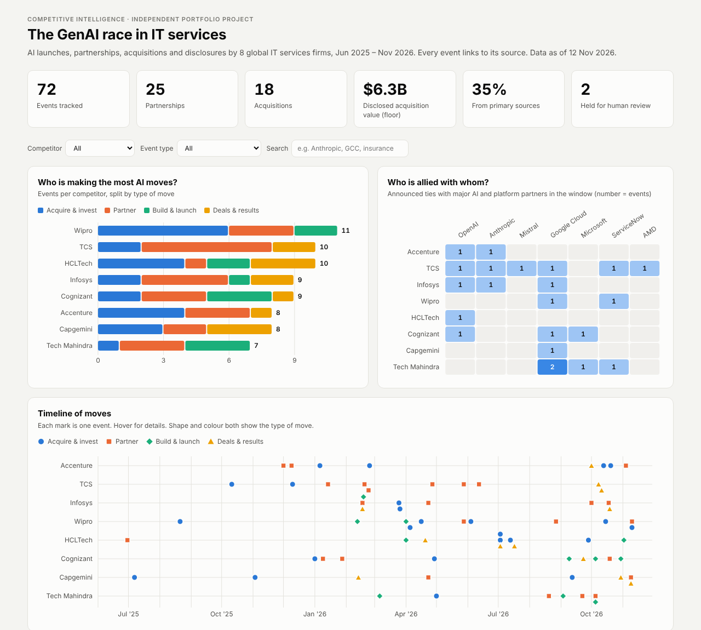
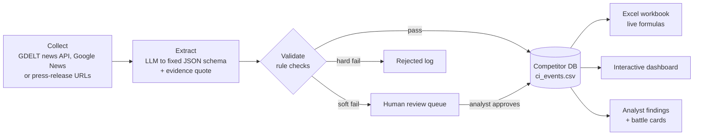

# AI-Powered Competitive Intelligence Tracker
### Who's winning the GenAI race in IT services?

An end-to-end competitive intelligence (CI) workflow. It uses an LLM to pull **launches, partnerships, acquisitions and AI disclosures** from public news, checks every event against its source, and turns the result into a **competitor database, battle cards and an interactive dashboard**.

**Competitors tracked (8):** Accenture · TCS · Infosys · Wipro · HCLTech · Cognizant · Capgemini · Tech Mahindra
**Window:** Jun 2025 – Nov 2026 · **Events:** 60 (58 verified, 2 held for review) · **Every event links to its source**

🔗 **Live dashboard:** https://lokpriye96.github.io/ai-ci-tracker/



---

## The business question

In 2026 every IT services firm says it is "AI-first". A CI or strategy team needs to know:

1. **Who is moving fastest**, and with what kind of moves (buy, partner, build)?
2. **Who is allied with which model labs and platforms** (OpenAI, Anthropic, Google, Microsoft…)?
3. **What does it mean** for positioning, deal pursuit and the next 90 days?

## Key findings (as of 11 Nov 2026)

| # | Finding | So what |
|---|---|---|
| 1 | **Access to frontier models is table stakes.** 5 of 8 firms announced OpenAI tie-ups; TCS has the widest model bench. | The edge has moved from *access* to *certified delivery capacity*. |
| 2 | **Talent is the product.** Cognizant has committed 25k people to OpenAI and 18k to Gemini; Wipro has 1,500 forward-deployed engineers; Capgemini runs "Outcome Deployed Engineer" pods. | Expect AI sold as named pods priced on outcomes. |
| 3 | **Two M&A playbooks.** Global majors buy scale (Capgemini–WNS $3.3B); Indian majors buy vertical tuck-ins. | WNS alone is worth more than every disclosed Indian acquisition in the tracker combined. |
| 4 | **Captive takeovers win deals.** Wipro, HCLTech, TCS and Infosys all used GCC transfers in 2026. | GCC leaders now face offers to absorb their centres. |
| 5 | **AI revenue disclosures can't be compared directly.** TCS reports $3.1B annualised (>10%); HCLTech $620M; Infosys 5.5% of quarterly revenue. | Normalise the definitions before benchmarking. |
| 6 | **Sovereign / India AI** is a new axis (HCLTech–Sarvam, TCS HyperVault, TechM–BharatGPT). | Regulated and public-sector buyers will weigh data location. |

Full write-up: [`outputs/key_findings.md`](outputs/key_findings.md) · Battle cards: [`outputs/battle_cards.md`](outputs/battle_cards.md)

---

## How it works



**Why the validation layer matters:** LLMs can make up facts. Every extracted event must include an `evidence_quote` copied from the article, and the pipeline **checks that quote against the article text**. If it isn't found, the event goes to human review instead of the database. Other checks include:

| Check | Action |
|---|---|
| Company not in tracked list · invalid or future date · no source / blocked domain | **Reject** |
| Evidence quote not found in article (possible hallucination) | **Review** |
| USD value extracted but no USD figure in article | **Review** |
| Model confidence low · article text unavailable | **Review** |
| Same company + type + counterparty within 30 days | **De-duplicate** |
| Company newsroom / wire service / exchange filing vs media | **Source tier** (Primary / Secondary) |

The test suite feeds in a deliberately **hallucinated acquisition**. The validator catches it and sends it to review (`tests/test_pipeline.py`).

## Outputs

| File | What it is |
|---|---|
| [`data/ci_events.csv`](data/ci_events.csv) | Structured competitor database (18 fields, source URL on every row) |
| [`outputs/CI_Tracker.xlsx`](outputs/CI_Tracker.xlsx) | Excel workbook: Events table, Company × Type matrix, Partner Map, Theme heat map, Key Findings, Battle Cards, Data Dictionary. All summary numbers are **live formulas**, so new rows update the analysis. |
| [`docs/index.html`](docs/index.html) | Interactive dashboard (filters, hover details, timeline, battle cards, evidence table) |
| [`outputs/battle_cards.md`](outputs/battle_cards.md) | One card per competitor: positioning, AI assets, strengths, gaps, how to compete |

## Runs automatically on GitHub

The pipeline runs in **GitHub Actions** every Monday, and on demand from the Actions tab ("CI tracker refresh" → *Run workflow*).
The LLM step uses **GitHub Models** with the repository's built-in token, so no API key is stored anywhere.
Every run is recorded in [`outputs/run_log.md`](outputs/run_log.md): articles read, events extracted, verified, held for review and rejected, each with its source. New verified events flow into the database, Excel and dashboard automatically. Held events wait in `data/review_queue.csv` for analyst approval.

## Run it yourself

```bash
git clone https://github.com/lokpriye96/ai-ci-tracker.git
cd ai-ci-tracker
pip install -r requirements.txt

# 1. Offline demo: no API key needed (sample article + mock LLM)
python run_pipeline.py --demo

# 2. Real run: get a free Gemini API key at https://aistudio.google.com/apikey
cp .env.example .env           # paste your key into .env
python run_pipeline.py --days 7 --dry-run   # preview (GDELT news + LLM)
python run_pipeline.py --days 7             # append verified events

# 3. Rebuild Excel, battle cards and dashboard from the database
python build_outputs.py

# Tests
pytest -q
```

Switch LLM provider with `CI_LLM_PROVIDER=gemini | anthropic | openai | github` in `.env`. Model names change often, so set `CI_LLM_MODEL` if the default has been retired.

## Project structure

```
ai-ci-tracker/
├── run_pipeline.py            # collect → extract → validate → store
├── build_outputs.py           # Excel, markdown, dashboard
├── prompts/extract_event.md   # the extraction prompt (versioned like code)
├── src/ci_tracker/
│   ├── config.py              # competitors, taxonomy, source rules
│   ├── collect.py             # GDELT / Google News + article text
│   ├── llm.py                 # Gemini / Claude / OpenAI adapters (plain REST)
│   ├── extract.py             # article → structured events
│   ├── validate.py            # guard-rails + de-duplication
│   └── insights.py            # analyst findings and battle cards
├── src/dashboard_template.html
├── data/ci_events.csv         # the competitor database
├── outputs/                   # Excel + markdown deliverables
├── docs/                      # dashboard (GitHub Pages) + methodology
└── tests/                     # offline tests with fixtures
```

## Method and limitations

- **Sources:** public news and company press releases only. 42% of events come from primary sources (newsroom, wire service, filing); the rest from business and trade media.
- **Human in the loop:** the LLM collects and structures the data; an analyst verifies sources and writes all findings. 2 events are deliberately left as *Needs review*.
- **Coverage, not completeness:** the tracker shows what was announced and captured in the window. It is not a complete list of every partnership a firm has.
- **Not like-for-like financials:** AI-revenue figures use each company's own definition.
- See [`docs/methodology.md`](docs/methodology.md) for the taxonomy and the review protocol.

## How this was built

This project practises what it studies: AI-assisted research with human control.

- **AI tools used:** LLM assistants (Claude, Gemini) for news collection, first-pass extraction and code scaffolding.
- **My role:** I set the business question, the competitor set and the taxonomy. I verified each event against its source and wrote the findings and battle cards. I also decided which events to hold for review.
- **Rule followed throughout:** no event enters the database without a source link, and no finding is published without an event ID behind it.

## Skills demonstrated

Competitive intelligence & battle cards · secondary research & source validation · LLM-assisted extraction (prompting, structured JSON output, hallucination controls) · Python data pipelines · Excel modelling with live formulas · dashboard design · insight synthesis for decision-makers

---

**Author:** Utkarsh Saxena, Market & Competitive Intelligence professional (TMT) · [LinkedIn](https://www.linkedin.com/in/utkarsh-lokpriye-)

*Independent portfolio project built on public information. Not affiliated with, or endorsed by, any company named. Not investment advice.*
